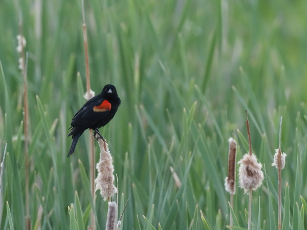

<strong>Photography Contest.</strong>

<strong>Joe Long, Honorable Mention.</strong>

<figure>

<figcaption><i><a href="https://en.wikipedia.org/wiki/Red-winged_blackbird">Agelaius phoeniceus fortis</a></i>, male &ndash; red-winged blackbird, Sunset Vista Natural Area, Larimer County, Colorado, June 13, 2024.  Subspecies identification based on location. Mr. Long writes, "Red-winged blackbirds are quite common in wetlands in this arid prairie only a couple of kilometers from the edge of the mountains.  In coal country, where I used to live, red-winged blackbirds were regarded as a bad omen, their coloration suggesting blood on coal.  Technical: Olympus OM-D EM-1 Mark III, Olympus 300 mm, F/4.0 lens on 2.0x teleconverter, 1/1000 s, F/8, ISO 6400, handheld."</figcaption>

</figure> 
