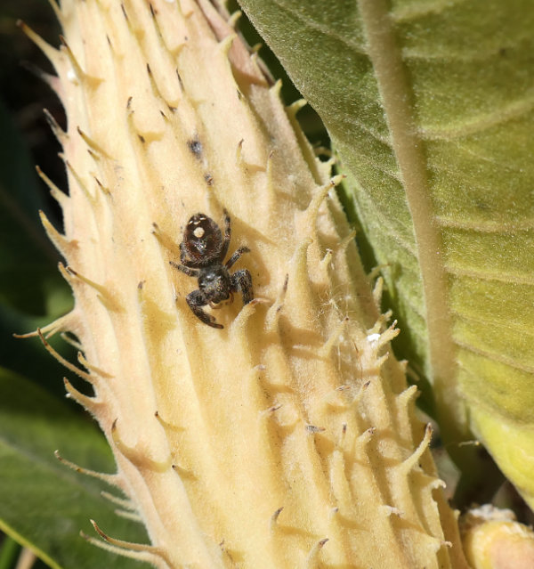

<figure>

<figcaption><a href="https://en.wikipedia.org/wiki/Phidippus"><i>Phidippus</i></a> sp., possibly <i>P. audax</i> (help?) &ndash; jumping spider, lounging on a pod of <a href="https://en.wikipedia.org/wiki/Asclepias_speciosa"><i>Asclepias speciosa</i></a> &ndash; showy milkweed, University of Colorado campus, October, 2026.</figcaption>
</figure>
