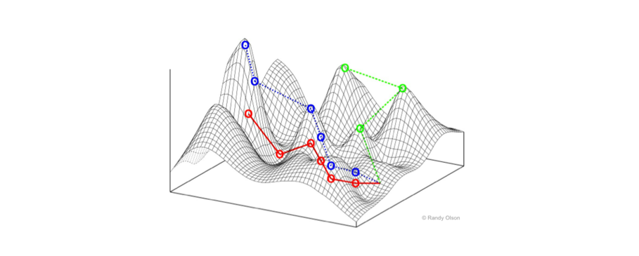

<figure>
 
<figcaption>
A fitness landscape computed from an NK-algorithm.   By <a href="//commons.wikimedia.org/w/index.php?title=User:Rhiever&amp;action=edit&amp;redlink=1" class="new">Randy Olson</a> - Own work, <a href="https://creativecommons.org/licenses/by-sa/3.0" title="Creative Commons Attribution-Share Alike 3.0">CC BY-SA 3.0</a>, <a href="https://commons.wikimedia.org/w/index.php?curid=32274330">Link</a>
</figcaption>
</figure>

&nbsp;

Not too long ago I became aware that William Dembski had a new 
article ([**here**](https://bio-complexity.org/ojs/index.php/main/article/view/BIO-C.2025.2/BIO-C.2025.2)) in the 
BIO-Complexity (the Discovery Institute's house 
journal).  And that a section of that article disputed my 
statements about smooth fitness landscapes (or fitness 
surfaces).

He is replying to a post by me here at Panda's Thumb on 
6 February 2025 ([**here**](https://pandasthumb.org/archives/2025/02/Conservation-of-arguments.html)).  He and Robert Marks
(and also Winston Ewert) had argued that there was a Conservation of Information 
law, that showed that when information gets into 
genomes, it must have already existed elsewhere. 
They said that this was even true when natural 
evolutionary processes put adaptive information 
into the genome -- it must have already existed, 
for example, in the fitness landscape.

Their argument (which can be seen [**here**](https://www.evoinfo.org/papers/2009_ConservationOfInformationInSearch.pdf) and
[**here**](https://bio-complexity.org/ojs/index.php/main/article/download/BIO-C.2013.4/BIO-C.2013.4)) 
uses the concept of "active information".  For situations in which 
there is a population evolving on a fitness landscape, active 
information can include the information embodied in the 
assignment of fitnesses to genotypes.  

Dembski, in his BIO-Complexity paper, summarizes 
my arguments thusly:

> 1. Real-life biological evolution requires smooth fitness landscapes.
> 2. Physics and chemistry guarantee that real-life fitness landscapes are smooth.
> 3. Any probability estimates of smooth fitness landscapes among the totality of fitness landscapes are
therefore irrelevant.
> 4. No-free-lunch theorems hold for the totality of fitness landscapes, both smooth and non-smooth.
> 5. No-free-lunch theorems therefore do not apply to real-life biological evolution.
> 6. Conservation of information is equivalent to no freelunch, so conservation of information is likewise
irrelevant to real-life biological evolution.

He argues that there are exceptions to all fitness landscapes being smooth, 
that I have conflated the No Free Lunch argument with his 
Conservation of Information argument, and that the 
latter is his essential argument.

Let's look at his refutation in some detail:

<!--more-->

We'll consider a simple case of evolution.  A case where we have a 
set of genotypes, and each possible one has a fitness.  Where 
there is a simple form of mutation which changes a genotype by 
substituting one base for another at one of the sites of 
the genotype.  The mapping between genotype and fitness 
is the fitness landscape.

## Dembski's 2002 argument ##

If we go back to his 2002 book, Dembski poses tne 
question of whether "algorithms" such as natural 
selection can explain the origin of Complex Specified 
information.  He argues (on page 149) that

> Algorithms and natural laws are in principle incapable
> of explaining the origin of CSI.  To be sure, algorithms
> and natural laws can explain the flow of CSI.  Indeed,
> algorithms and natural laws are ideal for transmitting
> already existing CSI.

Taking that position, in the case of a fitness landscape, 
if natural selection and other evolutionary processes 
achieve an increase in fitness great enough to be counted 
as Complex Specified Information, that information must 
be already existing in the form of the fitness landscape 
(or as he called them in 2002, fitness functions).

Dembski concludes (p. 195), for the case of an evolutionary 
algorithm, that it

> has borrowed specified complexity  
> from a higher-order phase space, namely, the phase space 
> of fitness functions.

## Where No Free Lunch comes in ##

For all possible genotypes (say 3 billion bases in a 
hapoid genome, with each base being one of A, C, G or T) 
the fitness is a nonnegative real number.  The set of 
all possible combinations of fitnesses is a *very* big 
space, and that does not even consider variation in the 
length of the genome.

To consider how much specified information comes from 
the particular fitness landscape, we need to know 
the probabilities of all possible combinations of fitnesses.
That is a very big space.

A much smaller and simpler space is the one considered 
by Wolpert and Macready in their No Free 
Lunch theorem ([**here**](https://www.cs.ubc.ca/~hutter/earg/papers07/00585893.pdf)). 
They consider one assignment of fitnesses to all of the 
possible sequences, and then permute those assignments in 
all possible ways.  Their No Free Lunch theorem shows that, 
averaged over all of these assignments, when they were 
weighted equally and the search algorithm looked at K genotypes in all, the success of search for higher 
fitnesses would be no better than choosing the best out of arandomly chosen 
K genotypes.

This means that when the search algorithm found success by 
moving one step in a particular direction, an algorithm that 
continues to move further 
that direction would not help with further gains.  When 
the fitness landscape is equally likely to see any permutation of fitnesses, 
there is no way to choose any good direction to move.

## Strong and unpredictable interactions between sites ##

In the No Free Lunch case, there are also typically very strong 
and unpredictable interactions between sites.  If we have two 
different sites in the genome, and find a favorable substitution 
at each of them, what happens when both of these substitutions 
have occurred?  The combination of them is yet another haploid genome, 
so that there is no way to predict what the fitness will be when 
both changes have occurred.  

## Is the No Free Lunch case the worst case for evolution? ##

The point of invoking the No Free Lunch theorem is to show 
a situation in which evolutionary change will do not better 
than a search that looked at the same number of genotypes, 
but which are picked at random from all possible genotypes.  Is that 
case one in which no progress is made?  No, some progress will 
be made.  By natural selection finding the highest fitness among K genotypes, 
we actually do put some functional information into the organism's 
genome even in the NFL case.

Stewart Kauffman and Simon Levin ([**here**](https://www.sciencedirect.com/science/article/abs/pii/S0022519387800292)) have done 
computer simulations on similar cases in genomes that 
have 0s and 1s instead of four bases.  There can be 
considerable progress, even in their NFL cases.

A worse case would be if the nest step were simply to 
a genotype randomly selected from those looked at; a 
case where there was no natural selection.

## How smoothness of the fitness landscape helps ##

We get even more functional information if we have a relatively 
smooth fitness landscape.  In that case after each step, 
there is quite often a chance for further progress on the 
next step.  The hazard is getting stuck on a local 
optimum, forever.  With an NFL landscape one gets stuck 
on a local peak rather quickly; on a fairly smooth 
landscape one can keep climbing for many steps.

An important point is that even in very rough 
fitness landscapes, natural selection can make some 
progress.  Even if we are not on a smooth surface.
So a predisposition to having a smooth surface 
is not the only reason for progress.

## Is intelligence required? ##

In William Dembski's 2002 book "No Free Lunch: Why Specified 
Complexity Cannot Be Purchased Without Intelligence", he argues 
that any evolution of specified complexity is due to 
choice of a special fitness landscape out of the 
set of all possible fitness landscapes:

> The upshot of these theorems is that averaged over all possible
> fitness functions, no search procedure outperforms any
> other.  It follows that any success an evolutionary
> algorithm has in outputting specified complexity must
> ultimately be referred to the fitness function that
> the evolutionary algorithm employs in conducting its
> search. The No Free Lunch theorems dash any hope of 
> generating specialized complexity via evolutionary
> algorithms.  (p. 196)

He identifies the source of the specified complexity 
as intelligence:

> The No Free Lunch theorems show that for evolutionary
> algorithms to output CSI they first had to receive
> a prior input of CSI.  And since CSI is reliably linked
> to intelligence, evolutionary algorithms, insofar as
> they output CSI, do so on account of a guiding
> intelligence. (p. 223)

## Is there a predisposition to smoothness in real fitness functions? ##

There is.  The easiest way to see this is to consider 
the effect on fitness of a single base change.  This can be 
bad, or even lethal, but in a great many cases it will 
only reduce the fitness moderately. 

Compare that to the effect of a single base substitution in 
the No Free Lunch world.  A single base substitution carries 
the genotype to the fitness of a randomly chosen other 
genotype.  A randomly chosen genotype differs from the 
previous one at about 3/4 of all sites.  In humans that would 
be one that differs from the previous genotype in 2,225,000,000 
bases.

If we were near the NFL type of fitness landscape, the 
average effect of a single base mutation would be similar to 
the effect of  over 2 billion simultaneous mutations.  With a 
single base change, We obviously aren't 
anywhere near that.  Mutations can be lethal, a fraction of 
the time.  But 2 billion mutations will essentially _always_ 
be lethal.  The difference between these shows that fitness 
landscapes are mostly much smoother than NFL landscapes.

## What did I say about physics and fitness landscapes? ##

Dembski's criticizes me arguments about smoothness of 
fitness landscapes thusly:

> Most fitness landscapes would thus be like hash functions
> in cryptography (Felsenstein describes them as “white
noise fitness surfaces”) where the slightest change in an
input completely alters the numerical output [42].
Now Felsenstein’s point is that such jagged fitness
landscapes, as allowed by no-free-lunch theorems, violate
biological reality. The fitness landscapes conducive to
evolvability, such as might characterize how genotypes
promote reproductive success, must, according to him,
be smooth. Why? Because of physics. Thus he remarks:
>> [I]t seems reasonable that physics itself predisposes fitness surfaces to be smooth. After all,
the forces of physics tend to be local in time
and space and to lose influence with greater
distance. If I gesture with my fingers, there
is hardly any effect on objects at a distance.
The floor of our room does not collapse, nor
does the ceiling cave in. Different objects are
scarcely affected by each other.

> The problems with this reasoning are numerous. In the
first place, physics does have a place for precipitous and
even nonlocal effects. Quantum entanglement is instantaneous
and unaffected by distance. Phase transitions
in nonlinear dynamics may produce radical changes in
the behavior of a system with but the slightest change
in a parameter. Felsenstein’s argument is based on folk
physics, not modern physics and as such is unconvincing.

Did I say that _all_ fitness landscapes in biology are 
completely smooth?  No.  But Dembski's refutation 
cites the mere existence of "precipitous" effects in physics 
as if I had 
made a statement about all such effects, without 
exception.  Fitness landscapes _tend_ to be smooth, 
that's all.  Enough to allow natural selection to 
often make progress.  And not always.  Ask the 
ammonites, the pelycosaurs, the 
seed ferns.

## A strawman, but no refutation ##

Dembski's reply is a strawman, or rather a 
straw-fitness-landscape.  It would be relevant if 
I had argued that all fitness landscapes are 
pleasantly smooth.  I am not refuted.

## No Free Lunch versus conservation of information ##

There is also the matter of whether Dembski did or 
did not use the NFL theorem to argue against the 
ability of natural selection to put specified 
information into genomes.  His 2025 BIO_Complexity 
paper says

> By themselves, the no-free-lunch theorems do not
refute Darwinism, nor have I ever claimed that they
do. Yes, I wrote a book titled No Free Lunch (pub
lished in 2002) that used the no-free-lunch theorems as
a springboard to critically re-examine the power of the
Darwinian mechanism in explaining biological complexity
and from there to argue that design is a better explanation of biological complexity. Yet Darwinian critics
of conservation of information have ever since conflated
conservation of information with no free lunch,

We have seen, above, his statements from the 2002 
book.   In that book, he argued from a Law of Conservation 
of Complex Specified Information.  Lately he has been 
arguing that the law that counts is not No Free 
Lunch, but the Law of 
Conservation of Information.  Yet in his recent 
second edition of _The Design Inference_, with 
Winston Ewert as co-author, he presents an extended 
argument, defining Algorithmically Specified 
Complexity, in a somewhat detailed argument.

Yet there are two parts of the argument completely 
missing in that book:

1. They do not explain why adaptations that
increase fitness must have a simple description.
2. They do not explain why, if adaptations did require
a short description, natural selection could not
bring that about.

I short, their book of over 700 pages leaves their 
supposedly-essential conservation of information 
argument unable to connect to adaptation by natural 
selection.

It would be nice to have them make this connection, 
because then we could evaluate their current 
not-the-same-as-No-Free-Lunch conservation-of-information 
argument against the ability of natural selection 
to incorporate specified information into a genome. 
It is currently missing.  Or does it simply not exist?

