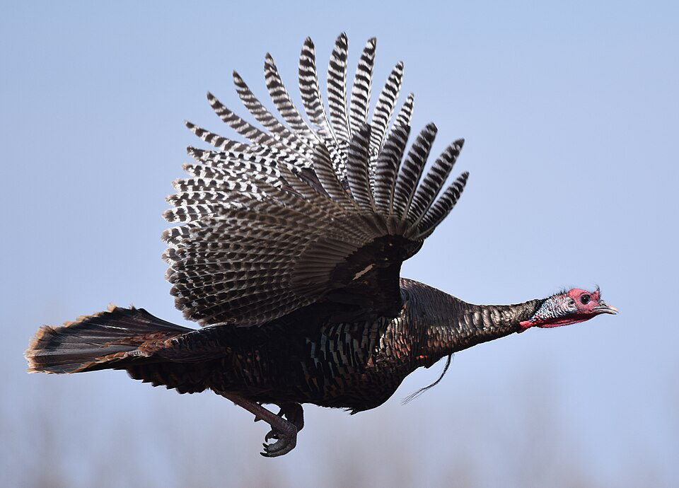

<figure>

<figcaption><i><a href="https://en.wikipedia.org/wiki/Wild_turkey">Meleagris gallopavo</a></i> &ndash; wild turkey, Horseshoe Lake, March, 2016. <small><a href="https://commons.wikimedia.org/wiki/File:Wild_Turkey_(25473218982).jpg">Photograph by Andy Reago & Chrissy McClarren</a>, Creative Commons Attribution 2.0 Generic.</small>
</figcaption>
</figure> 

Just a Thanksgiving reminder that in days of yore turkeys could fly.
